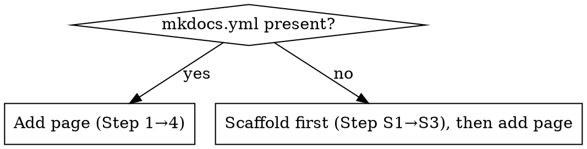

# MkDocs Documentation

## Overview

Handles two scenarios: adding a page to an **existing** MkDocs site, or **scaffolding** MkDocs into a repo that only has plain markdown files.

---

## Step 0 — Detect project state

```bash
ls mkdocs.yml 2>/dev/null && echo "exists" || echo "missing"
```



---

## Scaffold Path — when MkDocs is missing

### S1. Install MkDocs Material (no global install needed)

```bash
# one-shot preview without installing
uvx --with mkdocs-material mkdocs serve
```

Or add to project dependencies:

```bash
# pip
pip install mkdocs-material

# uv (recommended)
uv add --dev mkdocs-material
```

### S2. Generate `mkdocs.yml`

Create at repo root. Adapt `site_name`, `repo_url`, and `nav` to match the project:

```yaml
site_name: My Project Docs
repo_url: https://github.com/org/repo   # optional
theme:
  name: material
  features:
    - navigation.tabs
    - navigation.sections
    - toc.integrate

nav:
  - Home: index.md
```

### S3. Bootstrap `docs/`

If the repo already has markdown files (e.g. `ARCHITECTURE.md`, `docs/backend/`), wire them in:

```yaml
nav:
  - Home: index.md
  - Architecture: architecture.md   # symlink or copy ARCHITECTURE.md → docs/
  - Backend:
    - Overview: backend/overview.md
```

Or scaffold from scratch:

```bash
mkdir -p docs
echo "# Welcome" > docs/index.md
```

---

## Add Page Path — when MkDocs already exists

### 1. Create the markdown file

Place under `docs/` in the appropriate section. Use kebab-case filenames — spaces break MkDocs nav silently.

```
docs/
  <section>/<topic>.md     ← new file here
```

### 2. Register in `mkdocs.yml`

```yaml
nav:
  - Section Name:
    - Page Title: section/topic.md
```

Nav labels can contain spaces and em-dashes — only the file **path** must be slug-safe.

### 3. Add cross-references

- From the new doc → link related pages with relative paths (`../other.md`)
- From the nearest `index.md` → add a row/link pointing to the new file

### 4. Validate

```bash
# Prefer the project's own env (mkdocs-material in dev deps): no per-run
# resolution cost. Fall back to uvx only when mkdocs is not installed.
if command -v mkdocs >/dev/null 2>&1; then
  mkdocs build --strict 2>&1 | tail -10
else
  uvx --with mkdocs-material mkdocs build --strict 2>&1 | tail -10
fi
```

Build must complete with no `ERROR` lines. Pre-existing `INFO` warnings about unrelated anchors are acceptable.

---

## Hosting Options

### A. Local preview (quickest)

```bash
uvx --with mkdocs-material mkdocs serve
# → http://127.0.0.1:8000
```

Or add a helper script `host-mkdocs.sh`:

```bash
#!/usr/bin/env bash
uvx --with mkdocs-material mkdocs serve "$@"
```

```bash
chmod +x host-mkdocs.sh && ./host-mkdocs.sh
```

### B. Docker Compose (shared / persistent)

Add a service to your `docker-compose.yml`:

```yaml
services:
  docs:
    image: squidfunk/mkdocs-material
    ports:
      - "8000:8000"
    volumes:
      - .:/docs
    command: serve --dev-addr=0.0.0.0:8000
```

```bash
docker compose up docs          # foreground
docker compose up -d docs       # background (detached)
docker compose logs -f docs     # tail logs
```

Live-reload works because the repo root is mounted at `/docs`.

**Static build inside Docker (for CI / deployment):**

```yaml
services:
  docs-build:
    image: squidfunk/mkdocs-material
    volumes:
      - .:/docs
    command: build --strict
```

```bash
docker compose run --rm docs-build
# output → ./site/
```

### C. GitHub Pages (automated)

Add `.github/workflows/docs.yml`:

```yaml
name: Deploy Docs
on:
  push:
    branches: [main]
jobs:
  deploy:
    runs-on: ubuntu-latest
    steps:
      - uses: actions/checkout@v4
      - uses: actions/setup-python@v5
        with: { python-version: "3.x" }
      - run: pip install mkdocs-material
      - run: mkdocs gh-deploy --force
```

---

## Common Mistakes

| Mistake | Fix |
|---|---|
| Space in filename | Rename to kebab-case; MkDocs nav silently breaks |
| File created but not in `nav:` | MkDocs warns "not in docs_dir"; add to `mkdocs.yml` |
| Relative link depth wrong | From `docs/a/b.md` to `docs/a/index.md` use `../index.md` |
| Skipping build validation | Always run `mkdocs build --strict` before declaring done |
| Docker port already in use | Change host port: `"8001:8000"` |
| Plain `docs/` markdown ≠ MkDocs | Check for `mkdocs.yml` first (Step 0) before assuming site exists |
